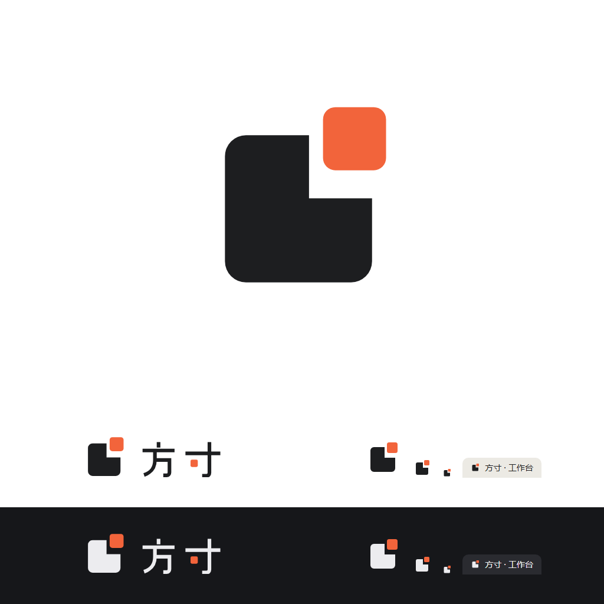

# 方寸 · 工作台

**方寸之间，万物归位。** 一个纯前端的文件工作台：任意类型的文件拖进来、拖出去，用看板、无限画布和功能区整理，做完的项目长按打包归档。

## 品牌

- **名称**：方寸 —— 小小一块地方装下所有文件，每样东西都有归处。
- **标志**：缺了右上角的方块（方），缺掉的那一小块（寸）悬在缺口外、正要落回原位，对应「完成 → 打包归位」。鼠标悬停页面左上角的标志时，小方块会落回缺口。
- **字标**：「方寸」用统一粗细的直线笔画搭建，「寸」的点替换成标志里的同一个小方块。
- **文件**：`brand/mark.svg`（标签图标，自动适配深浅色）、`brand/mark-light.svg` / `mark-dark.svg`、`brand/wordmark-*.svg`、`brand/fangcun-logo.png` / `.jpg`（白底总览）。

## 功能

- **作品**：顶部「作品」页存放个人作品（网站、设计、项目）。
  - 每个作品有名称、网站链接、GitHub 仓库、分类、状态（已上线 / 开发中 / 暂停 / 完结）、简介、标签，还可以附带文件（截图、设计稿、文档）。
  - **分类**：用分类栏筛选；把作品拖到分类标签上即可归类，右键分类标签可以重命名或删除。
  - **在线预览**：卡片封面直接显示网站首页的实时画面，点「预览」会弹出大窗口；详情页内嵌实时网页，可切换电脑 / 平板 / 手机尺寸、刷新、全屏。被嵌在 iframe 里时（比如在作品里预览方寸自己）不再加载预览，避免无限嵌套。
  - **更新日志**：在详情页手动记录（可写版本号、补记日期），也可以从 GitHub 同步——填了公开仓库（GitHub Pages 地址会自动识别出仓库），最近 100 条提交记录会自动变成日志。打开作品页时，超过 1 小时没同步的作品会在后台自动同步。日志可以筛选、编辑、隐藏，也能导出成 Markdown。右侧「更新动态」把所有作品的更新按时间汇总在一起。
  - **从 GitHub 导入**：输入用户名，列出公开仓库，有网站的默认勾选，一次导入。
- **白天 / 黑夜模式**：右上角按钮一键切换（从按钮处圆形扩散过渡），右键可选「跟随系统」；选择会记住。
- **优先级**：卡片上用方形印章字标「急 / 高 / 低」，「急」「高」另有同色左边线。卡片菜单设置，或选中卡片按 1 / 2 / 3（0 清除），多选时底部栏也可批量设置。
- **已完成项目分类**：分类栏（全部 / 各分类 / 未分类）筛选，「全部」下按分类分组。把文件夹拖到分类标签上即可归类，文件夹菜单也能设分类；右键分类标签可重命名或删除（文件夹变未分类，不会删除）。
- **子文件夹**：文件夹里可以「新建子文件夹」，层级不限，顶部面包屑可逐级返回。把文件夹拖到另一个文件夹的**上半部分 = 合并**、**下半部分 = 放进去**；把子文件夹拖到面包屑某一级上即可上移。文件数、封面、打包 zip（保留目录结构）、合并、删除（子文件夹自动上移一级）都按层级处理；菜单里也有「移到…」。
- **文件夹颜色**：新文件夹轮流分配八种颜色（苔绿、靛蓝、赭橙、玫红、葡萄紫、青碧、琥珀、石墨），标签页与封面底色随之变化，可在菜单里修改。
- **文件夹合并**：在「已完成项目」里把一个文件夹拖到另一个上即可合并（飞入动画，名称取公共部分，可撤销）；手机上用文件夹菜单「合并到…」。

- **模块化页面**：从顶部「画布」入口查看所有工作区。可在列表打开、新建、重命名或删除画布，也可以把文件拖到「画布」入口后选择目标工作区。
- **白板工具**：画布左侧工具栏，用法类似 Miro / FigJam：
  - **便签 / 文字 / 形状**：便签（N）、文字（T）、矩形（R）、圆形（O）、菱形（D）。点一下放默认大小，拖动画出想要的大小；放好后直接打字。双击空白处也能贴一张便签。
  - **箭头连线**：连线工具（L）从一个对象拖到另一个对象；也可以把鼠标移到形状或文件卡片上，从出现的四个连接点直接拖出。连线跟着对象移动，可以连到空白处。
  - **快速连出下一步**：从连接点拖到空白处松手，会在那里新建一个相连的同款形状并直接输入。选中形状后按 Ctrl + 方向键，会在该方向新建一个相连的形状。
  - **编辑**：
    - 单击选中，拖四角或四边中点调大小（四角按住 Shift 保持比例），再点一下或双击编辑文字。
    - 方向键微调位置（Shift 加大步幅）。
    - 便签字多了会自动缩小字号，其他形状会自动长高。
  - **多选**：Shift + 点击加选 / 减选，Shift + 拖动空白处框选，Ctrl+A 全选。多个形状可以一起移动、改颜色和字号、对齐 / 均匀分布、复制、删除。
  - **吸附对齐**：移动或调大小时，自动对齐到其他形状和卡片的边缘与中线，并显示参考线；按住 Ctrl / ⌘ 暂时关闭吸附。
  - **模板**：点左侧工具栏最下面的模板按钮（空画布上也有「从模板开始」），可以一键插入：
    - 海报设计：需求 → 灵感 → 草图 → 定稿检查 → 输出规格，附海报版式线框。
    - 网页开发：目标 → 站点地图 → 首页线框 → 开发任务看板 → 上线检查。
    - 功能开发：用户故事 → 验收标准 → 方案判断 → 任务拆分 → 测试 → 发布。
    - 头脑风暴、项目复盘。
    
    插入的都是普通便签和形状，放在已有内容右侧，不会重叠；Ctrl+Z 可以整体撤销。
  - **拖动修饰键**：
    - Shift + 拖动：只水平或只垂直移动（形状和文件卡片都可以）。
    - Alt + 拖动：原件留在原地，拖走一份副本。形状连同它们之间的连线一起复制；文件卡片连同文件内容一起复制。
    - Alt + 拖边 / 角：以中心对称缩放。
    - Alt + 画形状：从按下的点向四周画。
  - **快捷键**：
    - 撤销与重做：Ctrl+Z 撤销，Ctrl+Y 或 Ctrl+Shift+Z 重做。
    - 复制与删除：Ctrl+C / Ctrl+X / Ctrl+V 复制、剪切、粘贴（连同形状之间的连线），Ctrl+D 原地复制，Delete 删除。
    - 格式：Ctrl+] / Ctrl+[ 置于顶层 / 底层，Ctrl+B 加粗，Ctrl+Shift+. / , 放大 / 缩小字号。
    - 视图：Shift+1 显示全部，Shift+2 缩放到选中，Shift+0 回到 100%。
    - 按 `?` 或点画布底部的键盘图标，可以打开完整的快捷键速查表。
  - **平移**：在任何工具下按住空格拖动，或按住鼠标中键拖动。
  - **工具栏**：悬停显示名称和快捷键。双击某个工具可以锁定它连续放置；用工具时顶部会提示怎么用。
  - **格式条**：
    - 选中形状时可以改形状类型、填充颜色（点色块展开）、字号（12–96）、加粗、对齐、置顶。
    - 选中连线时可以改单向 / 双向 / 无箭头、反转方向、虚线、曲线、颜色，以及线上文字（双击连线也能加）。
  - 形状和连线存在画布里，会包含在 `.wbk` 备份中。
- **无限画布**：文件和便签随意摆放；拖动空白处平移、Ctrl+滚轮或双指缩放；双击空白处新建便签；方向键微调位置；「显示全部」「整理排列」一键归位；卡片右上角的下载图标可直接拖到桌面导出。
  - **Miro 级超高清原图与自由拖拽大小**：画布上的图片直接加载原始超高清大图（无需点击弹窗即可看清所有细节）；悬停或单击画布卡片出现八方向缩放手柄（四角与四边），按比例自由拖拽缩放大小（Alt 对称缩放），双击或点展开按钮可打开全屏弹窗预览。
  - **画布 PDF 直接高清预览与翻页**：画布上的 PDF 自动按当前卡片尺寸与画布缩放倍率实时渲染超清页面，底部内置翻页栏（上一页 / 页码跳转 / 下一页，选中时也可用 `PageUp` / `PageDown` 或 `[` / `]` 翻页），无需点开弹窗即可直接在画布上翻阅和拖拽放大。
- **功能区可伸缩**（宽屏）：
  - 点「»」或按 Ctrl+\ 收起成窄侧栏，侧栏上显示各区图标和数量，点哪个区就展开到哪个区。
  - 拖左边缘调宽度（240–560px，会记住）；拖到很窄松手就收起，双击边缘也能收起或展开。
  - 收起时拖文件或卡片过来，功能区会临时弹开，放下后自动收回；也可以直接放到侧栏图标上。区里新增文件时，数字会弹一下。
- **功能区**：右侧默认「素材区 / 草稿区 / 临时文件区」，可新建自定义功能区、重命名、排序、删除；临时文件区放入超过 7 天自动移到回收站（天数可改，任意功能区都能开启）。看板、画布、功能区之间卡片可以互相拖动。
- **智能关联**：内置名称关联算法，为每两个文件打分 —— 去掉「预览 / 终稿 / v2 / 第N页 / 日期」等后缀后，综合字符二元组相似度（Dice）、最长公共片段、包含关系；同一批拖入 +15%、10 分钟内加入 +5%；「IMG_1234 / 截图 / 微信图片」等通用名不参与。高分自动关联，中等分数作为「+N 建议」一键确认；转换生成的文件、手动关联永远优先。顶部「✨ 智能关联」面板可调灵敏度（严格 95% / 标准 80% / 宽松 66%）、逐条或全部接受建议、查看和拆开已识别的项目。
- **多选**：点击卡片的选择圈或 Ctrl/⌘ + 点击可单选加减。选中起点后，按 Shift 点击同一列表中的另一张卡片或它的选择圈，即可选中两端和中间的可见卡片。底部操作栏可「一起完成并打包」「关联为一个项目」「移到…」「删除」；在已选卡片上长按会一起打包，拖动会一起移动。
- **长按完成项目**：在看板 / 功能区 / 画布上按住任意卡片约 0.7 秒（出现进度环，关联文件同时高亮），它和所有关联文件会飞进纸箱、合盖打勾，送进「已完成项目」并自动建好同名文件夹（已有同名文件夹则并入）。可撤销；键盘用户可用卡片菜单「完成项目」。
- **已完成项目**：顶部「已完成项目」页，用项目文件夹归档彻底完成的东西（封面自动拼出前 4 个文件的预览）。归档方式：卡片拖到文件夹或「已完成项目」标签上、卡片菜单「归档到…」、看板列菜单「整列归档」；均可撤销。文件夹可重命名、排序、一键打包下载 zip；删除文件夹时里面的卡片回到草稿区，不会丢。
- **智能预览**：卡片自动生成缩略图 —— 图片、PDF 首页（含页数）、视频帧（含时长）、音频波形、Word 页面、Excel 表格、Markdown / 代码、PPT/Keynote 内嵌缩略图、Affinity（afpub/afdesign/afphoto）与 PSD 内嵌预览图。点开可读 Word、Excel（多工作表）、Markdown 排版内容。
- **转换圆环**：按住 `Ctrl`（Mac 用 `⌘`）在卡片上按下鼠标并拖动，弹出圆环，拖到哪一格松手就执行哪一格；回到中心或按 `Esc` 取消。
  - **正面「转换」**：这个文件能做的格式转换。图片还有「压缩 JPG」（长边 2048px）。多选至少两份 PDF 后，从其中一份打开圆环，即可按卡片显示顺序合并；多张图片也可合成一份 PDF。
  - **背面「操作」**：预览、下载、重命名、复制一份、完成项目、标为「急」、放入功能区、删除。
  - 滚轮或 `Tab` 翻面，弹出后可以松开 Ctrl。多选时对所有已选文件一起执行，结果放在原文件旁边。
  - 卡片菜单「转换圆环…」可以用点选的方式打开（触屏也能用），在那里调「圆环大小」（70%–140%）。
- **格式转换**：预览窗口底部一键转换，结果作为新卡片放在原文件旁边：图片 ↔ PNG/JPG/WebP/PDF、PDF → 每页 PNG/JPG、文字 TXT/Markdown、压缩副本或自选页码拆分；Word（DOCX）→ HTML/TXT/Markdown；HTML/TXT → Markdown；Excel → CSV/JSON；CSV → XLSX/JSON；Markdown → HTML；音频 → WAV；视频 → 封面 PNG/JPG 或音轨 WAV；Affinity → 预览图 PNG/JPG。拆分 PDF 时，切换不同颜色的部分并勾选各部分需要的页面。先勾起点，再按 Shift 勾选另一页，可以把中间页一起加入当前部分。可以添加更多部分，也可以点击缩略图查看大图。每个有勾选页面的部分生成一份 PDF。PDF 转 Markdown 提取文字，扫描件需先做 OCR。压缩优先尝试无损优化，必要时将页面转为图片，保留原文件。转换在浏览器本地完成。
- **动效**：卡片移动、排序、缩略图加载时平滑过渡（FLIP），新卡片入场、删除淡出、画布镜头缓动；系统开启「减少动态效果」时自动关闭。
- **看板**：默认「收件箱 / 进行中 / 已完成」，可新建、重命名、左右移动、删除列（删除列时卡片自动转入草稿区，不会丢）。
- **拖入**：从桌面/资源管理器把任意文件或整个文件夹拖到任意列的任意位置；也可点「添加文件」或直接 `Ctrl+V` 粘贴截图/文字。
- **拖出**：按住卡片拖到桌面或文件夹即可导出原文件（Chrome / Edge）；其他浏览器用卡片菜单里的「下载」。
- **回收站**：删除只是移到回收站，可撤销/恢复；只有「永久删除」才真正移除。
- **预览**：图片、视频、音频、PDF、文本/代码/CSV 在页面内直接预览。
- **便签**：快速记录文字，和文件一起排在看板里。
- **搜索**：`Ctrl+K` 聚焦，按文件名和便签内容过滤并高亮。
- **多标签页同步**：同一浏览器打开多个标签页时自动保持一致。

## 数据存储与防丢失

| 措施 | 说明 |
| --- | --- |
| IndexedDB 数据库 | 卡片元数据与文件内容分库存放在浏览器本地数据库，不上传服务器 |
| 原子写入 + 回读校验 | 卡片和文件在同一事务中写入，写完立即回读比对大小，失败自动回滚并提示 |
| 持久存储 | 自动申请 `navigator.storage.persist()`，避免浏览器空间不足时清理数据 |
| 回收站 | 所有删除先进回收站，可撤销 |
| 完整备份 `.wbk` | 一键导出全部卡片、原始文件、作品与更新日志、分类到一个备份文件；恢复时与现有数据合并 |
| 备份提醒 | 顶部状态栏显示上次备份时间，有改动且超过 3 天未备份时变为橙色 |

### 扩容：存到电脑文件夹

浏览器数据库的容量由浏览器按系统盘剩余空间分配，网页无法调高。点顶部存储状态 →「存储与容量」→「选择文件夹，扩容」（Chrome / Edge 电脑版），选一个空间充足的文件夹（如 D 盘）：

- 之后加入的文件直接写进「所选文件夹/工作台文件/」，容量 = 那块硬盘的剩余空间，资源管理器里也能看到。
- 可把浏览器里现有文件一键迁移过去；每个文件写入并核对大小后才从浏览器删除。
- 浏览器重启后可能需要点一次「授权」才能打开文件（缩略图不受影响）。
- 可随时「停止使用」，文件会搬回浏览器。
- 文件夹里的文件请勿手动改名或删除；若被删，预览和备份会提示并跳过，不影响其他文件。

> 注意：数据只保存在当前浏览器。清除浏览器数据、无痕模式或换电脑时不会跟随，请定期用「备份」导出到网盘/硬盘。

## 本地运行

纯静态站点，无需构建：

```bash
python -m http.server 8660
# 打开 http://localhost:8660
```

## 文件结构

- `index.html` 页面结构
- `style.css` 样式（自动适配深浅色、手机端）
- `app.js` 看板交互、拖拽、预览、备份
- `db.js` IndexedDB 数据层与 `.wbk` 备份格式
- `preview.js` 缩略图、富预览与格式转换（第三方库按需加载，包括 pdf.js、pdf-lib、Turndown 等）
